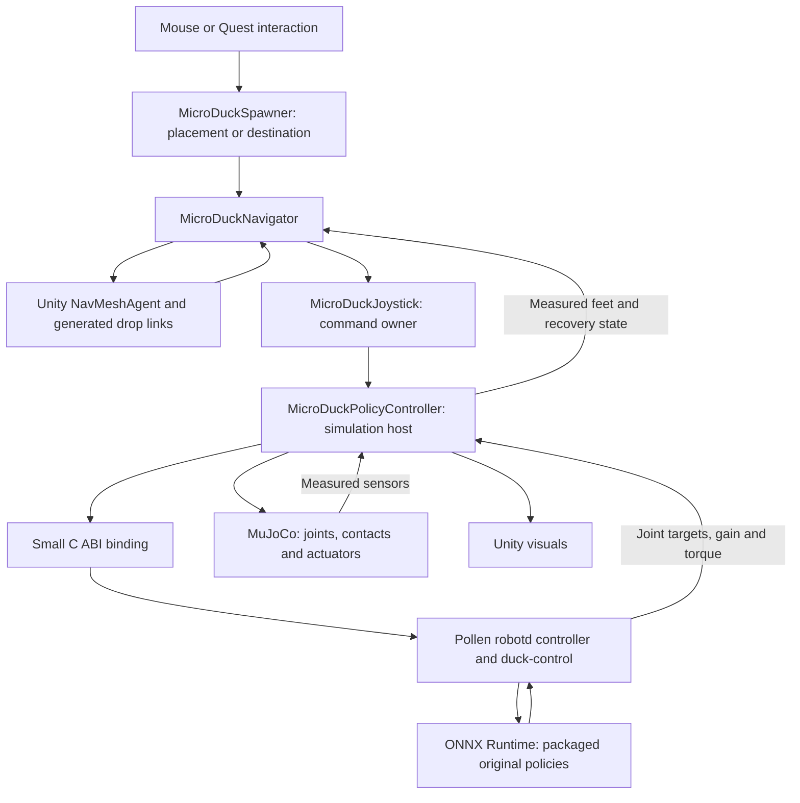

# MicroDuck herding

Unity **6000.6.3f1**. Supported control runtimes: Linux x86-64 and Quest Android ARM64.
Native libraries, Pollen policies and license notices are included in the project.
A normal clone needs Unity and its Android Build Support module; it does not need
Rust, Python, a running robot daemon, or separate policy downloads.

## Try it on Linux

Open the project in Unity. Choose **Tools → MicroDuck → Open Desktop Navigation
Trial**, then press **Play**. Click a surface to select a destination. Right-drag
to orbit and scroll to zoom. The trial starts on a table at **4×** simulation speed;
its panel also offers 1×/8×, pause, a goal behind the duck, and explicit placement.
Linux standalone builds use Mono; Quest uses IL2CPP.
Only an explicit reset/placement restarts the physical simulation. Falls retain
the selected destination and are handled by Pollen's controller.

The trial and Quest `MainScene` use the same duck prefab, spawner, physical
controller and navigator. The desktop camera and boxes are confined to the trial.

## Quest

For the shared integration, clone this branch directly:

```sh
git clone --branch codex/quest-robotd-integration https://github.com/Gabfuwak/microduck-herding.git
```

1. Open the project in **Unity Hub → Unity 6000.6.3f1**, with **Android Build
   Support**, its **SDK & NDK Tools**, and **OpenJDK** installed.
2. Open **File → Build Profiles**, select the included **Quest** profile, and
   click **Switch Profile**. Wait for Unity's Android import to finish.
3. Connect the Quest by USB with Developer Mode enabled and accept its USB
   debugging prompt. Select the headset as **Run Device** in Build Profiles.
4. Click **Build And Run**. For the first output location, choose
   `Builds/Android/MicroDuck.apk`. **Build** also produces an APK without a connected
   headset.

The profile builds `Assets/Scenes/MainScene.unity` and inherits the project's
**IL2CPP / ARM64**, OpenXR and existing Quest input configuration. Native libraries
and policy models are already tracked and packaged automatically; using the app
needs no Rust, Python, robot daemon, or separate model download. Build output is
local and is not checked into Git. Later code changes need only a normal rebuild.

Complete the room scan before placing the duck. First placement uses the currently
scanned surfaces for navigation; if you rescan or change the room layout, use the
hand menu's **Reset robot** action, then place the duck again. Headset input, room
capture and performance still require testing on a real Quest; the Linux trial does
not emulate them.

## Code boundaries



The desktop trial and Quest share these entry points:

| Change | Location |
| --- | --- |
| Placement and destinations | [MicroDuckSpawner](Assets/Robots/MicroDuck/MicroDuckSpawner.cs): call `TryPlaceOrNavigate(point, normal)` from code; keep scene callbacks using `PlaceOrNavigate` and `ResetRobot` |
| Routes, steering and permitted drops | [MicroDuckNavigator.cs](Assets/Robots/MicroDuck/MicroDuckNavigator.cs) |
| Physics, measured sensors and visual poses | [MicroDuckPolicyController.cs](Assets/Robots/MicroDuck/MicroDuckPolicyController.cs) and [MicroDuckSurfaces.cs](Assets/Robots/MicroDuck/MicroDuckSurfaces.cs) |
| Pollen inference and recovery | Packaged native core through [MicroDuckPollenControl.cs](Assets/Robots/MicroDuck/MicroDuckPollenControl.cs); [rebuild both native targets](Tools/PollenControl/README.md) only when changing the core |

Changes to the shared C# components need only the normal Unity rebuild on either
platform. The desktop camera, test boxes and accelerated time belong to the trial
scene and are excluded from the Quest profile.

Unity's agent advises a velocity and route; it never moves the physical duck.
The adapter limits command acceleration and turning rate. Actual measured motion
feeds the agent continuously, so drift changes subsequent commands. Unity's
`ledgeDropHeight` and build-source link generation connect permitted downward
routes. The duck crosses a link using its policy, then navigation binds again to
its measured landing position. Failed route queries and recovery retain the goal.

Pollen owns observations, policy selection/history, command filtering, startup,
fall detection and recovery transitions. The native library excludes hardware
serial buses, IPC and the daemon process shell. Unity supplies simulation time at
50 Hz, even when the desktop simulation runs faster than real time. MuJoCo runs
at 200 Hz. Actuator gains follow Pollen's commands; simulated motor load is the
same development proxy used by the daemon simulation adapter, rather than an
electrical servo model. Recovery can still fail when geometry physically traps
the robot; keeping a goal does not guarantee every obstacle is escapable.

## Reproduce or validate native assets

See [runtime packaging](Tools/PollenRuntime/README.md) and
[Pollen source extraction](Tools/PollenControl/README.md). Rebuilding native code
is a maintainer task; consumers use the included binaries. Package verification:

```sh
python3 Tools/PollenRuntime/prepare.py --verify
python3 Tools/PollenRuntime/validate.py
# After building an APK:
python3 Tools/PollenRuntime/validate.py --apk Builds/Android/MicroDuck.apk
```

Unity menu checks are **Tools → MicroDuck → Check Native Control Integration**
(in Edit mode) and **Check Navigation Integration** (in the playing trial).
See [validation notes](docs/validation.md) for the measured results and limits.
