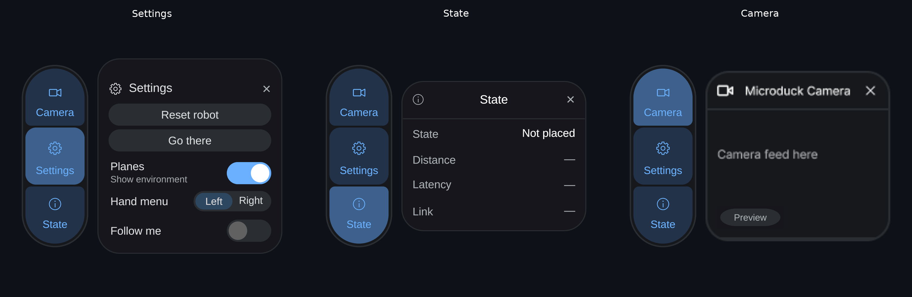

Team members: Gabin Maury, Tristan Mallétroit, André Dal Bosco

This is our final project submission to **Advanced Programming of Interactive Systems (CSC_5ID08_TP)**

The main idea of this project was to design and implement interaction with robots not based on controllers, but instead on hands gestures and voice commands; hopefully the way one communicates with a dog, for instance.

In robotics, one of the typical ways to control a robot is through controllers, which commands are passed through control software, which decides what specialized policy should run (stand, walk, etc.) which can finally control the robot's individual joints.

A microduck is a practical example of the above workflow, and so are robots in Disneyland parks (BDX, Olaf). Even if these last robots are meant to interact with people, they're controlled by an expert in possession of a physical controller.

In practice, we offer two high level commands to control the robot: "Follow me" and "Go there".

| Action | Usage |
|---|---|
| Spawn duck | Point at a detected horizontal surface, then pinch to confirm |
| Go there | Press **Go there** in the hand menu, then point and pinch to select a destination. |
| Follow me | Enable **Follow** in the hand menu. Disable it to stop following. |

## Build instructions

Our project was built entirely with Unity 6000.6.3f1. To run, please follow these instructions:

1. Install Unity 6000.6.3f1 through Unity Hub, including Android Build Support, SDK & NDK Tools, and OpenJDK, then open the project.
2. Open Assets → Scenes → MainScene and make sure it is the active scene.
3. Connect your Quest by USB, enable Developer Mode, and accept USB debugging in the headset.
4. In File → Build Profiles, check that Android is the active platform and MainScene is enabled in the scene list.
5. Under Player Settings → Other Settings, check that the scripting backend is IL2CPP and the target architecture is ARM64. Under XR Plug-in Management → Android, check that OpenXR is enabled and resolve any validation errors.
6. Select your Quest under Run Device and click Build And Run.

## Code organization

<table>
  <tr>
    <td width="50%" valign="top">
      
    </td>
    <td width="50%" valign="top">
      
    </td>
  </tr>
</table>

| Category | Description | File |
|---|---|---|
| UI | Hand menu switch appearance | [MicroDuckSwitchView.cs](https://github.com/Gabfuwak/microduck-herding/blob/19287db/Assets/UI/MicroDuck/MicroDuckSwitchView.cs) |
| UI | Hand menu controls for *Go there*, *Follow*, and *Reset* | [MicroDuckHandMenuControls.cs](https://github.com/Gabfuwak/microduck-herding/blob/19287db/Assets/UI/MicroDuck/MicroDuckHandMenuControls.cs) |
| Interaction logic | Pointing, target preview, and pinch to confirm | [MicroDuckTargeting.cs](https://github.com/Gabfuwak/microduck-herding/blob/19287db/Assets/Robots/MicroDuck/MicroDuckTargeting.cs) |
| Interaction logic | Place the duck or send it to the selected point | [MicroDuckSpawner.cs](https://github.com/Gabfuwak/microduck-herding/blob/19287db/Assets/Robots/MicroDuck/MicroDuckSpawner.cs) |
| Interaction logic | Manual steering with controller sticks | [MicroDuckJoystick.cs](https://github.com/Gabfuwak/microduck-herding/blob/19287db/Assets/Robots/MicroDuck/MicroDuckJoystick.cs) |
| Control logic | Room geometry for pathfinding and collisions | [MicroDuckSurfaces.cs](https://github.com/Gabfuwak/microduck-herding/blob/19287db/Assets/Robots/MicroDuck/MicroDuckSurfaces.cs) |
| Control logic | NavMesh pathfinding and steering | [MicroDuckNavigator.cs](https://github.com/Gabfuwak/microduck-herding/blob/19287db/Assets/Robots/MicroDuck/MicroDuckNavigator.cs) |
| Control logic | Standing and walking policies, MuJoCo simulation | [MicroDuckPolicyController.cs](https://github.com/Gabfuwak/microduck-herding/blob/19287db/Assets/Robots/MicroDuck/MicroDuckPolicyController.cs) |

## UI

Outside of hand gestures, the user can adjust some settings in different menus: Camera, Settings, and State

## External libraries

Third party code and assets were essential to allow a practical implementation of this project. We used:

- Unity packages: [XR Toolkit](https://docs.unity3d.com/Packages/com.unity.xr.interaction.toolkit@3.6/manual/index.html), [XR Hands](https://docs.unity3d.com/Packages/com.unity.xr.hands@1.9/manual/index.html), [AR Foundation](https://docs.unity3d.com/Packages/com.unity.xr.arfoundation@6.6/manual/index.html), [OpenXR](https://docs.unity3d.com/Packages/com.unity.xr.openxr@1.18/manual/index.html), [Meta OpenXR](https://docs.unity3d.com/Packages/com.unity.xr.meta-openxr@2.6/manual/index.html), [Inference Engine](https://docs.unity3d.com/Packages/com.unity.ai.inference@2.6/manual/index.html).
- Unity NavMesh: [Unity documentation](https://docs.unity3d.com/ScriptReference/AI.NavMesh.html).
- MuJoCo: [Unity integration and bindings](https://mujoco.readthedocs.io/en/stable/unity.html).
- MicroDuck assets: [Pollen’s model and training repo](https://github.com/pollen-robotics/microduck_rl), [pretrained policies](https://huggingface.co/pollen-robotics/microduck-policies).
- robotd: [Pollen’s robot software](https://github.com/pollen-robotics/microduck).

## Screenshots

